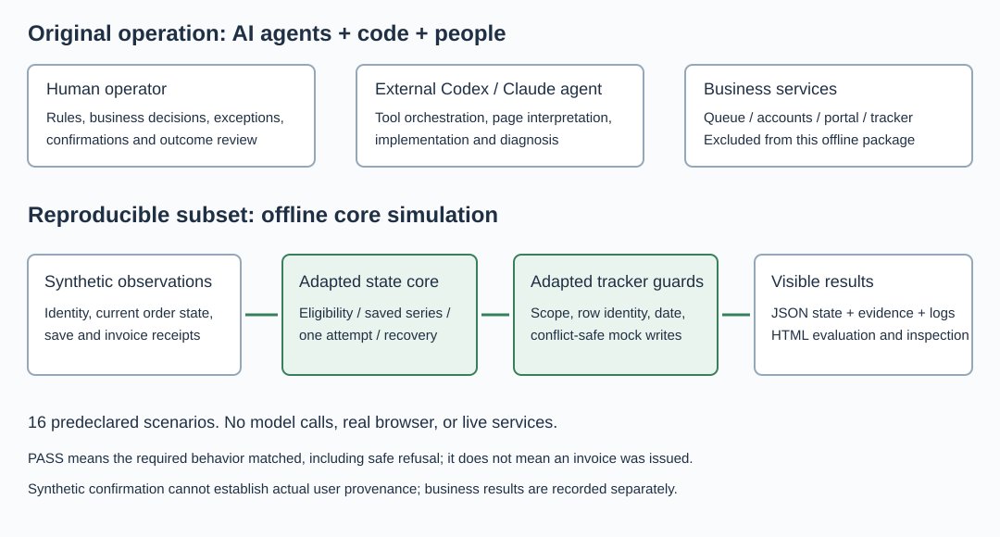

# Ecommerce Invoice Series Error Fix Automation

> Portfolio release 0.3.0. Synthetic offline core demo based on the BRSIP workflow. Historical business results and synthetic demonstration data are labelled separately.

[Open the English project home locally](index.html) · [Walk through one synthetic run](index.html#example) · [Read the full case](case-study.html)

A portfolio adaptation of the BRSIP invoice-series workflow, using AI agents for invoice exceptions, with explicit checks, saved progress, and visible results.

For every affected order, an operator had to confirm shop binding, enter the backend, find the invoice, manually change its series, issue it, and verify the result. I made this process explicit, used Codex and Claude to build and refine it, and established visual monitoring.

## Results

Based on my operational estimate, weekly human effort fell from 3–4 hours to about 20 minutes. The workflow also reduced the daily mindshare needed to remember, follow up on, and advance this work.

| Outcome | Before | After | Evidence |
| --- | --- | --- | --- |
| Weekly human effort | 3–4 hours | About 20 minutes | My operational estimate; human effort, not computer runtime |
| Daily attention | Remembering, following up on, and manually advancing individual orders | Less daily mindshare devoted to moving the process forward | My qualitative assessment |

Two retained Claude batches checked 17 orders: 9 issued by the workflow, 6 already issued, and 2 cancelled and skipped. All 17 matched tracker readback records. The weekly effort estimate reflects my operating experience.

## My contribution

- Structured and externalized the process into steps, inputs, rules, exceptions, and completion criteria.
- Used Codex and Claude to build the workflow, drive live trials, and turn failures into improvements.
- Pushed for reusable browser actions, compact responses, and recovery that preserved progress and prior attempts.
- Established visual monitoring of orders handled, results, processing time, and human interventions.

AI coding agents handled much of the implementation and execution. I defined the workflow, made operational judgments, drove iteration, and established monitoring.

## How it works

Scope: invoice-series errors 539 and 206, targeting series 747. Binding is reusable at the shop level; invoice checks and results are order-specific.

1. Identify current exceptions that still need attention.
2. Verify shop access, buyer, order, error, and invoice state.
3. Save the target series and reload to verify it.
4. Record the issuance attempt; reconcile an unclear result read-only.
5. Write back by shop and order, verify the record, and refresh monitoring.

## AI and code

| Part | Responsibility |
| --- | --- |
| Codex or Claude | Build and revise code, orchestrate browser work, interpret pages, diagnose exceptions |
| Python engine | Persist state and attempts, validate evidence, generate writeback and monitoring data |
| JavaScript helpers | Perform repeated browser actions and capture page evidence |
| Operator | Define rules, make required confirmations, handle exceptions, review outcomes |

The agents ran through Codex or Claude sessions; the local engine had no standalone model API integration.

## Example

One historical order went from error 539 and series 004 to verified series 747. Its ledger recorded one issuance attempt, the portal showed a downloadable invoice, and the tracker readback matched.

The [full case study](CASE_STUDY.md) covers the operating problem, iterations, failures, and evidence.

## What I learned

- Own the business outcome. I am accountable for delivering the result stakeholders need, regardless of how it is achieved.
- Choose projects for impact, feasibility, and frequency. Frequent use exposes problems sooner, keeps context fresh, and creates more opportunities to iterate.
- Design observability from day zero. Signals that show whether a workflow is on track and where it fails make debugging much easier.

## Run or inspect the demo

[Open the retained simulation results](examples/verified-run/review.html) or run the same 16 scenarios yourself. No company accounts, model keys, network access, or third-party packages are needed. The offline run calls the adapted original state and tracker rules with synthetic tools; it makes **no model calls** and does not operate the live portal.

Use Python **3.12** (tested with 3.12.14; code requires 3.10 or newer). From this directory:

```sh
python3 --version
python3 -B -m invoice_demo --output demo-output
python3 -B -m unittest discover -s tests -v
```

Open `demo-output/review.html`. The directory must be new; the command refuses to overwrite existing outputs. To rerun, choose a new name such as `demo-output-2`. Outputs include the evaluation JSON, per-scenario results, state, synthetic evidence, tracker snapshots and structured `run-log.jsonl`.

The 16 predeclared cases cover 539/206, existing/cancelled invoices, identity mismatches, missing or agent-labelled confirmation, uncertain/confirmed recovery, insufficient save/readback evidence, moved/conflicting tracker rows and environment/hash mismatches. Each expected field must match. A correctly blocked case passes its test; it does not count as an issued invoice. [Inputs](examples/scenarios.json) and [expectations](examples/expectations.json) are separate files.

Fifteen integration tests also cover output preservation, malformed inputs, checkpoint changes, stale checks, cancellation before issue, duplicate tracker rows and use of changed synthetic identifiers. The same-machine isolated restoration check is documented in `VERIFICATION.md`; a different computer or OS has not been tested.

## Two original dashboards

Both project dashboards are included, separately from the new core evaluation page:

- [Codex workflow evolution](dashboards/evolution.html): the original five-phase process matrix, retained from the Nov 6 Codex snapshot. The Claude engine mirror had empty phase data, so it is not the source used here.
- [Claude returned Operations monitor](dashboards/monitoring.html): the latest UI in the provided return, whose source data was generated Nov 12. It retains the four charts for problem population, handled outcomes, runtime/order and human interventions. The online artifact itself has not been verified.

[Open the two-dashboard index](dashboards/index.html). No original business history or identities are included. The Operations monitor uses **14 illustrative daily samples (Jan 5–18)** to demonstrate varying order volumes, outcomes, zero-task days, example runtime/intervention values and missing metrics. All numbers are invented layout samples, not measured business or core-run performance. The evolution performance tab retains its small core fixture. Actual core scenario results stay separate in the evaluation page and `dashboards/monitoring-core-results.json`. Host-only dashboard APIs are replaced with an offline shim. D3 7.9.0 is bundled with its license, so viewing requires no network or package installation. [Source/version notes](dashboards/sources.json) identify the two originals.

## Architecture and sources



The executable subset adapts the state transitions and tracker guards from two original modules. The broader agent, browser, account binding and operating environment are documented rather than reconstructed. [Source and adaptation notes](PROVENANCE.md) explain what changed and which claims the demo cannot establish. No open-source license has been selected for this candidate.

## Limitations

Browser access, page layout, and operator confirmations remained dependencies. An early live batch acted before the expected confirmation; later authorization records were a mitigation, while the root cause remained open.

Weekly effort is my estimate, not a controlled study. Independent handover is unverified. Company data and credentials are outside the proposed demo; the sources and limits of this public adaptation are described in PROVENANCE.md.
